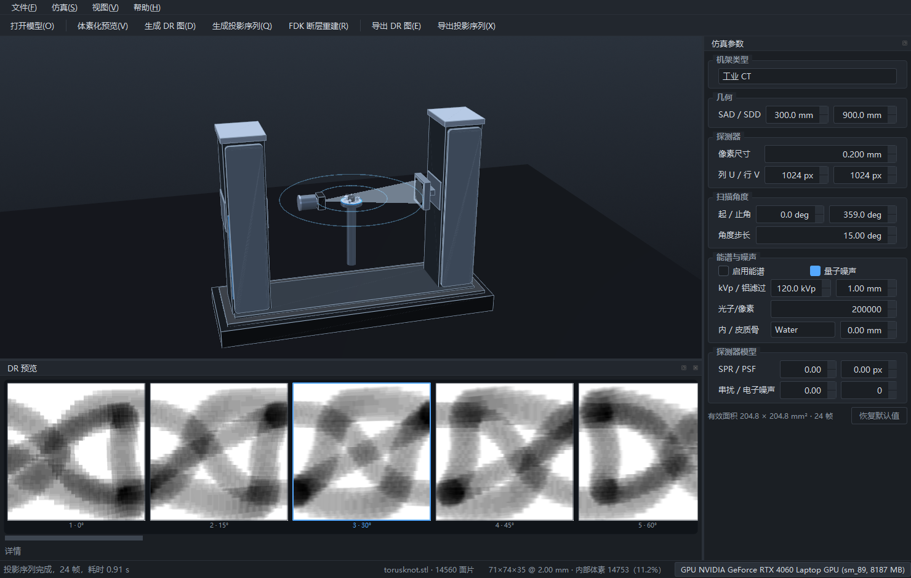
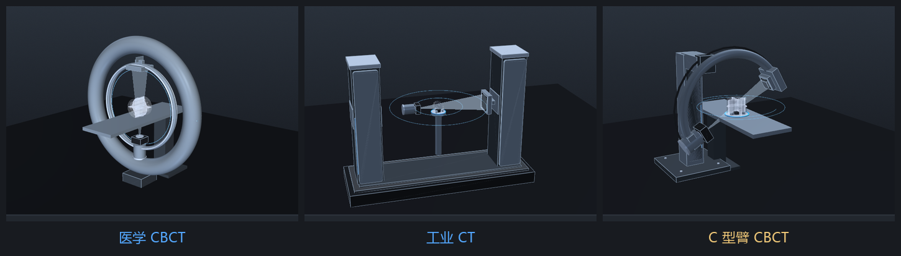
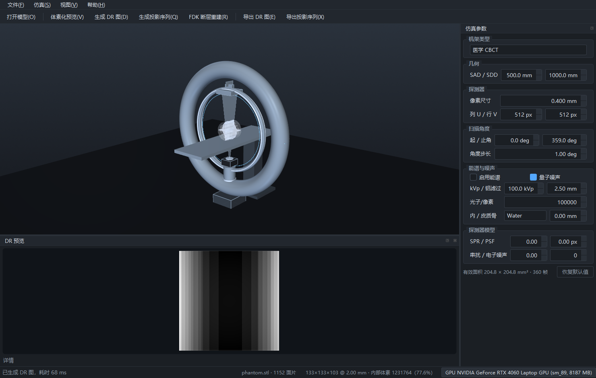
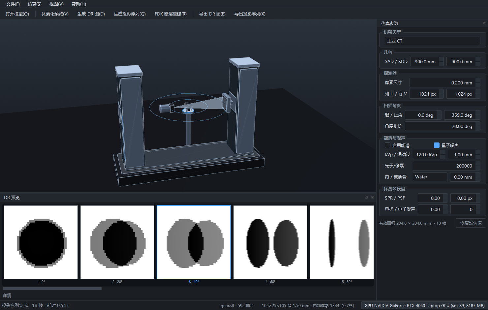
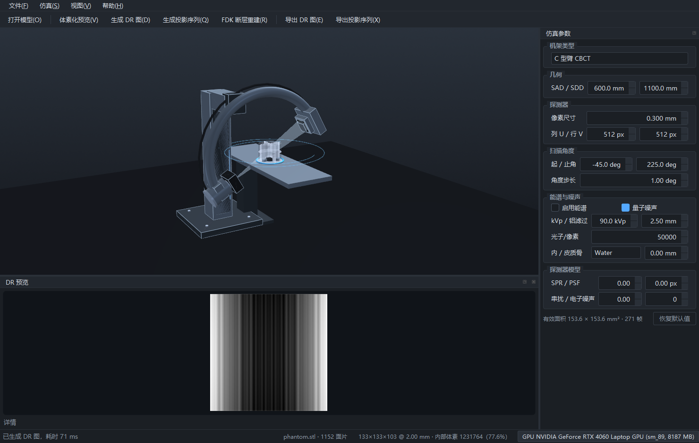
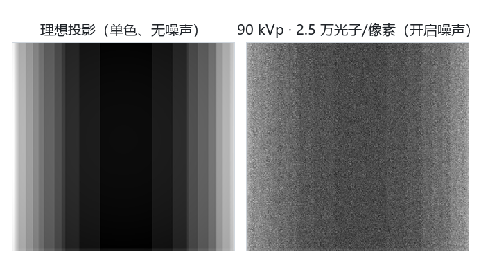



# PrecisionCBCTSim

**桌面级锥束 CT 成像仿真软件**

版本 0.1.0　　平台 Windows 10 / 11（64 位）　　机架 医学 CBCT · 工业 CT · C 型臂 CBCT

 

| 章节 | 内容 |
| :-- | :-- |
| [1. 产品概述](#1-产品概述) | 软件定位、核心特征 |
| [2. 功能一览](#2-功能一览) | 能力矩阵 |
| [3. 扫描机架](#3-扫描机架) | 三种机架的构型与运动关系 |
| [4. 成像物理模型](#4-成像物理模型) | 能谱、衰减、噪声、探测器响应 |
| [5. 工作流程](#5-工作流程) | 从模型到断层图像的四个阶段 |
| [6. 参数说明](#6-参数说明) | 每个参数对结果的影响 |
| [7. 示例数据](#7-示例数据) | 随软件附带的示例模型 |
| [8. 运行环境](#8-运行环境) | 硬件与系统要求 |
| [9. 快速上手](#9-快速上手) | 五分钟完成第一次扫描 |
| [10. 常见问题](#10-常见问题) | 使用者最常提出的问题 |
| [11. 版本与路线图](#11-版本与路线图) | 当前能力与后续计划 |

---

## 1. 产品概述

PrecisionCBCTSim 是一款面向教学、科研与设备验证的三维锥束 CT（CBCT）成像仿真软件。软件以可交互的三维机架模型呈现射线源、准直器、平板探测器与样品转台的几何关系，并在同一套物理模型下完成体素化、X 射线投影计算、投影序列生成与 FDK 断层重建。

机架的三维外观与投影计算由同一组几何参数（SAD、SDD、探测器像素尺寸与行列数）驱动，参数调整与视觉反馈始终保持一致，可直接用于扫描几何的推演、对比与验证。

 图 1　主界面：三维机架视图、扫描参数面板与投影序列预览

> 　三维模型不承担装饰作用：所有结构件的位置与尺寸均由投影几何推导。变更 SAD 或 SDD，机架、锥束与样品占比会同步变化，因此图像所见即为计算所用。

---

## 2. 功能一览

 图 2　核心计算能力：能谱与噪声、探测器响应、锥束投影、FDK 重建

| 能力 | 说明 |
| :-- | :-- |
| 三种扫描机架 | 医学 CBCT、工业 CT、C 型臂 CBCT，运行中切换并自动套用该机架的推荐扫描参数 |
| 真实尺度机架模型 | 球管、准直器、平板探测器、样品转台、检查床与机架结构按 SAD / SDD / 探测器幅面生成 |
| 网格体素化 | 支持 STL / OBJ，按指定体素尺寸生成体素网格，报告网格规模、内部填充率与耗时 |
| 锥束投影 | 任意起止角与角度步长，输出单张 DR 或整段投影序列 |
| 能谱与噪声 | 管电压、铝滤过、入射光子数、量子噪声开关，含束硬化效应 |
| 探测器模型 | 散射伪影、点扩散函数、像素串扰、电子噪声 |
| 断层重建 | FDK 锥束重建，支持体素规模设定与切片序列导出 |
| 数据导出 | 16 位 PNG 格式的 DR、投影序列与重建切片 |

---

## 3. 扫描机架

三种机架覆盖临床与工业两类典型锥束 CT 构型。机架的三维模型、推荐几何与推荐能谱均随所选类型切换，切换后仍可单独调整各项参数。

 图 3　三种机架的形态对照：医学 CBCT、工业 CT、C 型臂 CBCT

### 3.1 医学 CBCT

环形机架配可升降检查床，机架绕患者旋转，为临床锥束 CT 的常规构型。推荐几何 SAD 500 mm / SDD 1000 mm，推荐探测器像素 0.4 mm、512 × 512。

 图 4　医学 CBCT：环形机架、检查床与锥束照射范围

### 3.2 工业 CT

花岗岩底座配双立柱门架，微焦点射线源与平板探测器分别固定在两根立柱上，射线沿水平方向穿过样品，样品置于中间的水平转台上自转。推荐几何 SAD 300 mm / SDD 900 mm，适合小视野、高分辨率检测。

 图 5　工业 CT：双立柱门架、水平射线与样品转台

### 3.3 C 型臂 CBCT

C 形弧臂跨于手术床两侧，一端球管、一端平板，弧臂按临床常用的 AP 位呈倾斜姿态；样品置于床面的水平转台上自转。推荐几何 SAD 600 mm / SDD 1100 mm，扫描范围 −45° 至 225°。

 图 6　C 型臂 CBCT：弧臂、手术床与床面转台

### 3.4 运动关系

| 机架 | 运动部件 | 静止部件 |
| :-- | :-- | :-- |
| 医学 CBCT | 机架（射线源与探测器）绕患者旋转 | 患者检查床 |
| 工业 CT | 样品与水平转台绕竖直轴自转 | 射线源与平板探测器 |
| C 型臂 CBCT | 样品与水平转台绕竖直轴自转 | 弧臂、射线源与平板探测器 |

工业 CT 与 C 型臂采用"机架静止、样品旋转"的构型，与真实设备一致；其投影几何与"机架旋转、样品静止"完全等价，重建与序列代码无需分支处理。

---

## 4. 成像物理模型

### 4.1 能谱与衰减

管电压与铝滤过决定入射能谱；射线沿路径穿过体素网格，按材料线衰减系数积分得到透射强度。多能近似下可观察到束硬化现象，表现为均匀圆柱体投影边缘偏暗、中心偏亮。

### 4.2 噪声

开启量子噪声后，每个探测器像素接收的光子数按泊松分布抽样，噪声水平由入射光子数直接决定，可用于评估低剂量条件下的成像质量。

### 4.3 探测器响应

散射伪影（SPR）、点扩散函数（PSF）、像素串扰与电子噪声共同作用于投影图，使"理想像素"逐步过渡为真实平板探测器的成像特性。

 图 7　同一模型在理想条件与开启能谱噪声条件下的投影对比

> 　关闭「启用能谱」与「量子噪声」可得到单色、无噪声的理想投影，适合验证重建算法本身；需要评估实际成像质量时再逐项打开，两者的差异即为物理模型带来的影响。

---

## 5. 工作流程

 图 8　从三维模型到断层图像的四个阶段

1. **导入模型** —— 打开 STL / OBJ 模型，软件计算包围盒并将样品放置于转台之上。
2. **体素化** —— 指定体素尺寸生成体素网格，界面显示网格规模、内部填充率与计算耗时。
3. **投影计算** —— 选择机架类型，调整几何、探测器与扫描角度参数，输出单张 DR 或整段投影序列。
4. **重建与导出** —— 执行 FDK 重建得到断层图像，结果可导出为 16 位图像序列供后续分析。

---

## 6. 参数说明

| 参数 | 作用 |
| :-- | :-- |
| SAD / SDD | 射线源至旋转轴、射线源至探测器的距离，决定放大倍率、锥束张角，同时决定机架尺寸 |
| 像素尺寸 / 行列数 | 探测器感光面的物理幅面与采样密度，决定视野与图像分辨率 |
| 起止角 / 角度步长 | 扫描弧段与投影帧数，支持短扫描与半圈扫描 |
| 管电压 / 铝滤过 | 入射能谱硬度，影响对比度与束硬化程度 |
| 入射光子数 / 量子噪声 | 剂量水平与噪声强度 |
| SPR / PSF / 串扰 / 电子噪声 | 探测器响应特性 |
| 内 / 皮质骨材料 | 样品材质分配，直接影响衰减计算 |

<b>参数面板的辅助信息</b>

 

- 面板底部实时显示探测器有效面积与当前参数下的投影帧数，便于在修改前预估计算量。
- 「恢复默认值」回到当前机架的推荐配置；切换机架类型时同样会重置为该机架的推荐参数。
- 参数可保存为 JSON 预设并重新载入，预设中包含机架类型，便于在不同样品之间复用同一套扫描条件。

---

## 7. 示例数据

软件安装目录下的 `samples` 文件夹附带三个可直接打开的示例模型：

| 文件 | 内容 | 推荐用途 |
| :-- | :-- | :-- |
| `sample_gear.stl` | 直齿轮，含中心孔 | 工业 CT 的齿形与孔壁检测 |
| `sample_torusknot.stl` | 环面结，结构自遮挡明显 | 投影序列与角度覆盖演示 |
| `sample_phantom.stl` | 柱状体模，含多种插件 | 医学 CBCT、C 型臂的对比度与均匀性评估 |

---

## 8. 运行环境

| 项目 | 要求 |
| :-- | :-- |
| 操作系统 | Windows 10 / 11（64 位） |
| 内存 | 8 GB 及以上；大尺寸网格建议 16 GB |
| 显卡 | 支持 OpenGL 的显卡；NVIDIA 显卡可选用 CUDA 加速，无可用设备时自动使用多线程 CPU |
| 硬盘 | 约 500 MB（含运行库与示例模型） |
| 显示 | 1280 × 800 及以上，支持高 DPI 缩放 |

软件采用绿色部署：Qt、VTK 与 CUDA 运行库随安装目录一并提供，目标机无需另行安装。

---

## 9. 快速上手

1. 解压发布包至任意目录，运行 `PrecisionCBCTSim.exe`。
2. 打开 `samples` 中的示例模型，或自行导入 STL / OBJ 文件。
3. 在参数面板选择机架类型，按需调整几何与探测器参数。
4. 点击「体素化预览」检查网格与内部结构。
5. 生成 DR 或投影序列；如需断层图像，执行 FDK 重建并导出结果。

> 　首次使用可先以较大的体素尺寸（如 2 mm）试算整条流程，确认几何与参数无误后，再缩小体素尺寸做正式计算，可显著缩短等待时间。

---

## 10. 常见问题

**软件属于图像处理工具还是仿真工具？**

仿真工具。投影由三维模型按锥束几何计算得出，可用于验证扫描几何、剂量水平与重建算法，而非对已有影像做后处理。

**是否必须使用 NVIDIA 显卡？**

不必须。未检测到可用 CUDA 设备时，软件自动使用多线程 CPU 完成投影与重建，仅计算时间不同。

**工业 CT 与 C 型臂为何是样品旋转？**

两类设备的实际构型即为射线源与探测器固定、样品随转台旋转。软件按此实现，投影几何与真实设备一致。

**支持哪些模型格式？**

STL 与 OBJ。三角网格质量越高，体素化结果越准确。

**可以导出哪些数据？**

单张 16 位 DR、整段投影序列、FDK 重建后的切片序列，均为通用 16 位 PNG 图像。

**参数设置出现偏差如何恢复？**

点击参数面板的「恢复默认值」回到当前机架的推荐配置；切换机架类型同样会重置为该机架的推荐参数。

---

## 11. 版本与路线图

当前版本 0.1.0，已实现三维机架可视化、网格体素化、锥束投影、投影序列、能谱与噪声模型、探测器模型以及 FDK 断层重建。

| 计划项 | 内容 |
| :-- | :-- |
| DICOM 数据读写 | 使重建结果可直接导入影像工作站 |
| 定量分析模块 | ROI 统计、HU 标定、MTF 与 NPS 曲线 |
| GPU 实现 | 体素化与反投影的 CUDA 版本 |
| 材料库扩展 | 覆盖常见金属与复合材料 |

---

 
PrecisionCBCTSim 0.1.0　·　本文档随软件版本更新

